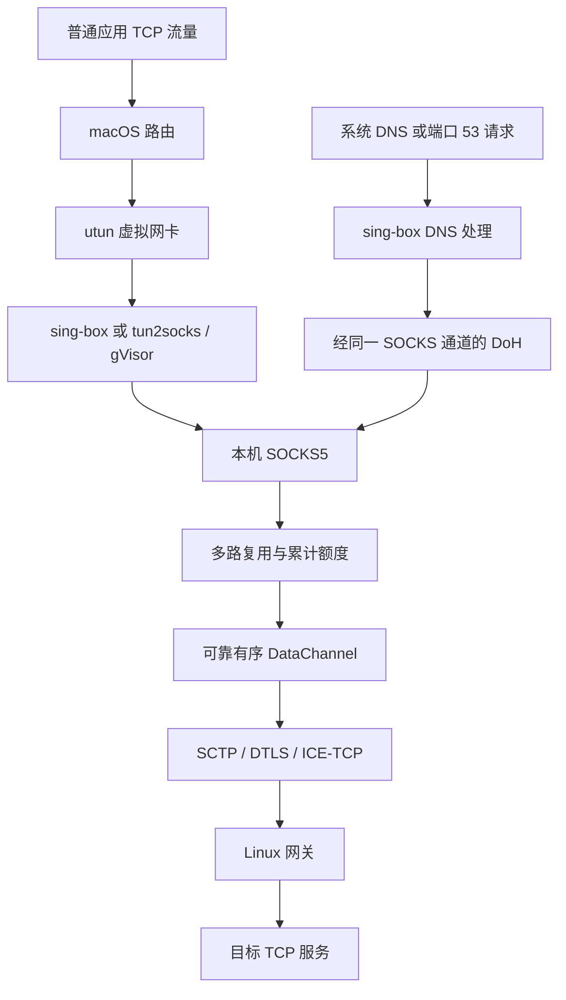

# 基于 WebRTC/ICE-TCP 的 macOS 全局代理：多层流控重构与 4K60 播放的工程研究

**作者：** H264Proxy 项目贡献者
**日期：** 2026 年 10 月 31 日
**文档类型：** 中文工程研究论文，项目内技术报告，未经同行评审
**研究版本（本地检查点）：** `f5929c6` → `581f737` → `cb02985`，GitHub 对应提交见第 8.1 节。

## 摘要

本文研究一个保留 WebRTC/ICE-TCP 传输的 macOS 全局代理系统，重点分析应用层额度、DataChannel 发送背压与底层 SCTP 窗口之间的相互约束。系统以 sing-box 或 tun2socks 接收 TUN 流量，通过本地 SOCKS5、多路复用协议与可靠有序 DataChannel，将 TCP 连接转发至 Linux 网关。针对视频播放吞吐不足，本文先比较 TUN 前端，再检查发送方向日志，最后实现接收额度扩展、发送水位参数化及阻塞观测。

前端比较包含两个模式各八次下载尝试；sing-box 的成功串行下载中位数为 2.95 Mbps，原前端为 2.35 Mbps，但并发总吞吐均值分别为 2.56 与 3.21 Mbps，且 sing-box 出现一次下载提前关闭。由于背景流量、网络变化及分段续跑，结果不支持某一前端具有总体性能优势。在隔离 mux 流控的 80 ms 模拟 RTT 实验中，单流额度由 256 KiB 扩为 1 MiB，吞吐从 2.64 MB/s 提高到 7.61 MB/s，约为原值的 2.88 倍。随后，在客户端保持 1 MiB 接收额度、网关发送高低水位调整为 1 MiB / 512 KiB 后，用户观察到 3840×2160、60 fps 的实际播放，播放器估算连接速度为 70,519 Kbps。

本文的结论是：固定的上层流控额度可能在底层拥塞窗口尚有余量时限制吞吐；按方向观测并独立调整这些额度，是本系统中有效的工程路径。模拟结果验证了机制，播放观察证明了该配置的一次应用可行性，但二者均不能证明持续 70 Mbps、长期无卡顿或对其他协议的性能优势。

**关键词：** WebRTC；ICE-TCP；DataChannel；SCTP；TUN；累计流控；背压；带宽时延积

## 1. 引言

将普通应用流量接入代理，需要同时解决流量捕获、DNS、远端传输和生命周期管理。TUN 能接收 IP 包，却不自动提供代理协议；传输协议可提供可靠交付，却不保证应用层始终向其提供足够数据。仅替换虚拟网卡前端，或者仅扩大某一缓冲区，均不足以确定吞吐限制所在。

H264Proxy 的开发过程呈现了这一问题。用户在其他代理中获得了较好的视频体验，但本系统最初只能维持较低画质。这一反馈构成调查动机；由于缺少同一节点、同一时段的 VLESS 对照测量，本文不据此认定两种协议经历相同路径，也不报告 VLESS 性能数据。

项目名称保留了早期 H.264 实验的历史。**本文研究版本不把代理数据编码为 H.264 视频，也不通过 RTP 视频轨道传输代理负载**，而是使用可靠有序的 WebRTC DataChannel。DataChannel 的标准协议基础见 [RFC 8831](https://www.rfc-editor.org/rfc/rfc8831)。

本文围绕三个问题展开：

1. 更换 TUN 前端能否解释原有吞吐不足？
2. 如何在多层缓冲和流控之间定位更直接的限制？
3. 如何扩大额度，同时保持旧端兼容、可观测性和资源约束？

本文贡献为一个可检查的工程案例：记录包含失败的前端比较；实现不改变初始线协议假设的接收额度扩展；提供方向明确的阻塞计数、正确性测试和可回滚部署。本文不提出新的传输标准，也不宣称所得参数普遍最优。

## 2. 背景与系统边界

### 2.1 WebRTC、ICE 与 SCTP

ICE 通过候选地址和连通性检查选择通信路径，相关机制见 [RFC 8445](https://www.rfc-editor.org/rfc/rfc8445)。TCP 候选及其连接过程由 [RFC 6544](https://www.rfc-editor.org/rfc/rfc6544) 描述。本系统选择 ICE-TCP，仍保留 DTLS 与 SCTP，不能将其等同于裸 TCP 代理。

SCTP 提供可靠消息传输、分片、流内排序及拥塞控制；其标准见 [RFC 9260](https://www.rfc-editor.org/rfc/rfc9260.html)。系统将多条应用连接复用到一个可靠有序 DataChannel 上。因此，逻辑流的额度相互独立，但底层关联和传输连接仍共享资源。

### 2.2 utun 与 TUN 前端

macOS 的 utun 是虚拟网络接口机制；sing-box TUN 和 tun2socks 是利用该机制处理流量的软件组件，三者不能作为同层替代品比较。本文比较的是前端处理、DNS 与路由集成，而不是更换 macOS 内核虚拟网卡机制。

sing-box 的 TUN 接口、自动路由和协议栈选项见其[官方文档](https://sing-box.sagernet.org/configuration/inbound/tun/)。实验固定为 **sing-box 1.14.4、gVisor 和 MTU 1500**；文档或软件后续版本的变化不属于本实验变量。

### 2.3 功能范围

本文数据面终止本地 TCP，再由网关建立远端 TCP 连接，不构成完整的端到端三层 VPN。当前实现处理 TCP 和隧道内 DNS；通用 UDP/QUIC 转发仍不受支持。捕获 IPv6 默认路由用于降低直接旁路风险，并不保证 IPv6 目标可达。

同仓库中的原生 Apple Network Extension 客户端是未签名开发原型，不属于本文 4K60 播放的实验路径。本文实际运行的是需要管理员授权的命令行 TUN 前端。

## 3. 系统架构



客户端对每条 TCP 连接创建逻辑流；网关收到 CONNECT 请求后建立目标连接，并在两个方向转发数据。关闭流程保留 FIN 半关闭语义：一方结束发送，不应立即截断另一方尚未接收的数据。

在可靠 DataChannel 模式下，mux 已把重传和拥塞控制交给 SCTP，使用 16 KiB DATA 分块。历史 RTP 模式使用的较小分块和重传机制，不能直接套用于本研究版本的性能解释。

sing-box 前端的唯一网络代理出口是本机 H264Proxy SOCKS5。DNS 通过同一通道访问 `1.1.1.1:443`，TLS 校验名称为 `cloudflare-dns.com`；没有直接 DNS 回退。DoH 的 HTTP 映射语义见 [RFC 8484](https://www.rfc-editor.org/rfc/rfc8484.html)。默认 IPv4 策略对 AAAA、HTTPS 和 SVCB 查询返回 NOERROR/NODATA，避免应用选择当前网关无法可靠处理的 IPv6 路径或服务提示。

路由配置必须排除信令与 ICE 传输端点，避免代理自身再次进入 TUN。父进程记录原网络服务的 DNS，启动健康检查通过后才切换，退出时恢复；sing-box 负责其自动路由，恢复记录负责父进程持有的变更。实现细节见 [TUN 文档](../TUN.md) 与 [sing-box 接入说明](../SINGBOX_TUN.md)。

## 4. 瓶颈分析与设计

### 4.1 带宽时延积与多层限制

维持目标速率所需的在途数据量，可用带宽时延积估算：

$$
W_{\mathrm{BDP}} = \frac{R_{\mathrm{target}}\cdot RTT}{8}
$$

其中速率单位为 bit/s，RTT 单位为秒，所得窗口单位为字节。以 25 Mbps 和 200 ms 为例，需要约 625,000 字节，即 610 KiB；256 KiB 的量级明显小于这一目标。

更一般地，在持续供数、稳定反馈时延等简化条件下，可作以下量级估算：

$$
R_{\mathrm{useful}} \lesssim \min\left(C_{\mathrm{path}},\frac{8W_{\mathrm{SCTP}}}{RTT_{\mathrm{SCTP}}},\frac{8W_{\mathrm{credit}}}{RTT_{\mathrm{credit}}}\right)
$$

这不是严格的本实现吞吐定理：发送水位存在停写与恢复的滞回，反馈会合并，SCTP 与应用层观察到的时延也不完全一致。该模型用于提出可测假设，不用于从窗口值直接预测实际视频速度。

### 4.2 必须按方向解释日志

下载由网关发送，因此应观察网关的 SCTP 拥塞窗口和发送缓冲；客户端相应指标主要约束上传。将客户端发送 cwnd 用作下载上限，会产生错误归因。

调查记录显示，若干网关下载会话的 SCTP cwnd 中位数约为 280–400 KiB，后续会话达到约 1 MiB，而应用发送高低水位仍为 256 KiB / 64 KiB。与此同时，单流初始额度为 256 KiB。这个差异支持优先检查上层额度，但窗口较大本身不证明底层始终空闲。

实现层面，Pion SCTP 的缓冲量在写入时增加，并在确认相关数据后释放；它不只是一个完全独立于在途数据的操作系统发送队列。相关版本源码见 [Pion SCTP v1.12.0](https://github.com/pion/sctp/blob/v1.12.0/stream.go)。本文因此把发送水位作为实际背压控制变量，而非笼统地将所有缓冲都调大。

### 4.3 参数化发送水位

新实现保留原默认值，同时提供独立参数：

| 参数 | 默认值 | 允许范围 | 作用方向 |
|---|---:|---|---|
| DataChannel 高水位 | 256 KiB | 32 KiB–8 MiB | 本端发送 |
| DataChannel 低水位 | 64 KiB | 0 至高水位以下 | 本端发送恢复 |
| 单流接收额度 | 256 KiB | 256 KiB–4 MiB | 对端向本端发送 |

高低水位均为零时使用原默认组合。扩大水位可能增加排队与内存占用，因此不自动改变默认值，也不把最大允许值视为推荐值。

### 4.4 接收额度扩展及兼容性

系统原有 WINDOW 消息携带单调递增的累计授权字节数。改造沿用这一语义，而不修改双方隐含的初始 256 KiB 授权。接收端在收到该流首个唯一 DATA 后，才发送扩大后的累计额度。

这一时序有明确原因：反馈帧具有优先级，若在发送 OPEN 时立即另行排队 WINDOW，后者可能先到达，而对端尚不认识该流。首包 DATA 证明流已经存在，随后广告扩展额度可避免这一启动竞态。

该机制利用旧端已经理解的累计授权语义。项目测试覆盖新实现采用默认额度与扩展额度的非对称组合；实际流程还观察到新客户端能够与未升级的原网关通信。本文不由此声称所有历史版本均已验证兼容。

接收端按唯一字节数计费，包括乱序缓存；重复帧不重复扣减额度。超过已授予额度的数据触发会话关闭并记录错误。此约束限制单流未消费字节数，并不等同于整个进程的 RSS 上限。

### 4.5 阻塞观测

新增计数区分三个位置：DataChannel 等待缓冲下降、逻辑流等待额度，以及生产者等待 mux 写队列。分别记录次数、累计等待时间及当前等待者数量，并记录调用底层发送接口的累计耗时。

计数具有两个解释约束：并发流累计等待时间可以超过墙钟时间；底层写耗时包含 DataChannel 背压等待，二者不能相加解释为总停顿。分析时应使用测量区间内增量，并保持发送方向一致。Pion 提供的 SCTP 参数能力可见[版本化源码](https://github.com/pion/webrtc/blob/v4.2.26/settingengine.go)，但本轮没有同时修改 SCTP 拥塞算法参数。

## 5. 实验设计

本文将证据分为四类，避免把不同来源的数字直接混合比较。

| 证据层级 | 方法 | 能回答的问题 | 主要限制 |
|---|---|---|---|
| 正确性测试 | 内存传输与真实本地 ICE-TCP | 完整性、关闭、额度与取消是否正确 | 不反映公网吞吐 |
| 流控模拟实验 | 80 ms RTT 的无限速内存链路 | 扩大额度能否缓解该模型的等待 | 不包含 WebRTC 或真实丢包 |
| 公网前端比较 | TUN 前端 ABBA 下载与 DNS 查询 | 本次条件下各前端的功能与观测差异 | 存在背景流量、CDN 与续跑影响 |
| 播放观察 | 用户提供的 YouTube 统计截图 | 特定配置曾达到何种播放状态 | 不是连续吞吐或长期稳定性测量 |

实验客户端为 Apple M4、macOS arm64；网关为 Linux x86_64，使用同一 VPS 和 ICE-TCP。依赖固定包括 Pion WebRTC v4.2.26、Pion SCTP v1.12.0、sing-box v1.14.4 和 tun2socks v2.6.0。精确浏览器版本、网关 CPU 型号以及所有时段的完整系统资源轨迹未归档，因此不将它们视为已控制变量。

### 5.1 正确性测试

测试包含默认/1 MiB 额度的双向组合、数据哈希与 FIN、慢读端停止供数、被额度阻塞的写入取消、第二条小流在大流阻塞时仍可交付、满写队列关闭、重复和乱序数据的唯一计费，以及超额发送拒绝。另有真实本地 ICE-TCP、DTLS 与 SCTP 链路上的大数据传输测试。

这些测试通过，说明相关受测路径满足预期；它们不是所有输入和全部历史二进制的形式化证明。

### 5.2 TUN 前端比较

比较顺序为原 tun2socks、sing-box、sing-box、原 tun2socks。每阶段进行两次串行和两次并发的 4 MiB HTTPS 下载，访问 Cloudflare 测速端点。curl 显式禁用代理配置，先验证实际 TUN 路由与预期 VPS 出口，再记录时间、吞吐和完整响应哈希。

DNS 测试对三个域名分别查询三次 A 记录，并检查 IPv4 策略；sing-box 另测向硬编码 DNS 地址发送请求时的劫持行为。每阶段结束后检查 DNS 与传输路由恢复。

实验曾因工具问题或功能失败停止并续跑，故属于**带暂停的 ABBA 顺序观察**。首次 A 查询仅表示本地该进程首次测试，不意味着公共递归 DNS 或权威服务器缓存为空。成功串行样本的中位数必须与失败率一起报告。

### 5.3 流控隔离实验

在每个方向加入 40 ms 延迟，形成约 80 ms RTT；帧在写入时记录预定交付时间，读取仅等待剩余延迟，避免对每帧额外串行睡眠而人为限制链路速率。链路本身不设速率限制，不使用 SCTP 或公网。每次操作传输 2 MiB 数据并验证内容，比较 256 KiB 与 1 MiB 接收额度，各运行三次迭代。

### 5.4 部署与播放观察

先扩大客户端接收额度，再将新版网关发送高低水位设为 1 MiB / 512 KiB；客户端发送水位和网关接收额度保持原值。网关更新使用原子替换、程序和配置备份、启动失败回滚，并验证运行程序哈希、环境变量与 TCP 监听。端口、共享密钥和防火墙配置不随此操作改变。

此过程形成分阶段的工程迭代，而非预注册、随机化且可独立归因的公网窗口消融实验。部署后截图作为补充应用观察，不与模拟实验合并计算性能倍数。

## 6. 结果

### 6.1 更换前端没有呈现一致的吞吐优势

| 指标 | 原 tun2socks | sing-box |
|---|---:|---:|
| 成功串行下载中位数 | 2.35 Mbps | 2.95 Mbps |
| 成功并发对总吞吐均值 | 3.21 Mbps | 2.56 Mbps |
| 下载失败 / 尝试 | 0 / 8 | 1 / 8 |
| 首次 A 查询中位数 | 257.9 ms | 179.1 ms |
| 重复 A 查询中位数 | 11.2 ms | 10.3 ms |
| 保留测量阶段的 A 查询失败 / 总数 | 0 / 18 | 0 / 18 |
| 平均启动时间 | 2.87 s | 2.86 s |

串行成功样本中位数提高约 25.7%，并发均值却降低约 20.2%。旧前端两阶段的并发总吞吐分别约为 1.38 和 5.04 Mbps，阶段间差异大于前端汇总差异。四阶段活跃 mux 流数采样峰值分别为 37、19、46 和 30，说明背景连接并未隔离。

此外，一次较早的 sing-box 尝试中，`i.ytimg.com` 首次 A 查询约 10 秒无响应，随后的查询成功；该失败保留在先前尝试记录中，不能被最终阶段的 18/18 成功率抹去。保留的下载测量中，一次响应尚余 4,148,569 字节即提前关闭，curl 返回错误 18。其余七次 sing-box 下载完整结束。日志未隔离出该提前关闭的根因。

因此，本文选择 sing-box 作为后续观察前端，依据包括 DNS 劫持和路由管理的集成能力，而非宣称其已经通过吞吐优越性检验。完整阶段数据见[公开实验摘要](data/tun-abba-20261031.json)和[前端比较报告](../SINGBOX_COMPARISON.md)。

### 6.2 扩大额度在隔离模型中减少等待

| 接收额度 | 平均每次操作耗时 | 吞吐 | 每次操作额度等待 |
|---|---:|---:|---:|
| 256 KiB | 794.1 ms | 2.64 MB/s | 710.4 ms |
| 1 MiB | 275.5 ms | 7.61 MB/s | 190.6 ms |

吞吐比约为 2.88，额度等待下降约 73%。MB/s 使用十进制单位，单次负载为 2 MiB；两者不应混写。该结果支持“上层额度不足可以限制高时延路径”的机制解释。三次迭代没有提供充分的独立重复或置信区间，所得倍数不外推到公网。数值与条件见[模拟实验摘要](data/window-latency-20261031.json)。

### 6.3 显式窗口配置达到一次 4K60 播放状态

| 配置阶段 | 当前播放规格 | 播放器估算连接速度 | 缓冲 | 丢帧 / 总帧 |
|---|---|---:|---:|---:|
| 客户端接收额度 1 MiB | 2560×1440 @ 60 fps | 12,393 Kbps | 4.77 s | 95 / 1,339 |
| 再扩大网关发送水位 | 3840×2160 @ 60 fps | 70,519 Kbps | 4.86 s | 84 / 2,163 |

两张截图使用 VP9，但并非同一时刻、同一缓存状态和相同负载下的受控对照。不能据两者估算速度差异计算优化倍数。后一张截图证明当时实际播放规格达到 4K60；70,519 Kbps 是播放器估算值，不是经独立工具测得的持续链路速率。

后一观察的丢帧比例约为 3.9%，缓冲不足 5 秒，因此不足以认定长期平稳播放。丢帧也不能单凭截图归因于网络，解码和渲染需要单独观测。转录数据见[播放观察摘要](data/playback-observations-20261031.json)。

## 7. 讨论与有效性限制

**第一，不能把所有改善归因于 TUN。** 前端比较没有产生一致优势，额度隔离实验和发送方向日志提供了更直接的调查线索。本文未测量所有层的 CPU、内存带宽和排队，因此不能排除其他瓶颈。

**第二，大缓冲不是无代价的优化。** 多流共享同一有序 DataChannel 和底层连接。缓冲越大，潜在排队和内存占用也越大。快速下载时 DNS、网页首开和交互延迟是否恶化，尚无完整分位数数据。

**第三，证据不支持与 VLESS 的性能排序。** 缺少同节点、同时段、同目标和相同协议条件的对照。用户的其他代理体验用于提出问题，不作为论文结果。

**第四，统计效力有限。** 公网阶段样本少、非随机顺序、含暂停，且存在背景流量与公共 CDN 变化；模拟实验也没有足够独立重复。本文不报告显著性检验，也不宣称某个百分比改善具有普遍性。

**第五，失败记录仍然有效。** DNS 超时和提前断流的根因未完全定位。公开摘要保留先前尝试，成功样本统计未将失败转换为零时延或静默删除。

**第六，恢复验证有边界。** 正常退出后的 DNS 和传输路由恢复检查通过；部署完成后验证了进程和监听。本文没有以受控故障注入覆盖所有强杀、睡眠、换网和长期重连场景，启动成功也不能替代端到端转发验证。

**第七，公开材料不是完整原始日志。** 仓库提供去除环境标识的数值摘要，原始应用日志、完整路由表和截图未随论文发布。读者可以复算公开摘要，但不能独立还原每个网络事件。也没有连续 30–60 分钟的播放时间序列。

## 8. 复现方法与版本对应

### 8.1 版本

| 本地检查点 | GitHub 公开对应提交 | 研究中的作用 |
|---|---|---|
| `f5929c6` | [`b80ed96`](https://github.com/rockage/h264proxy/commit/b80ed9641a05ec78392a2dd104047a22d0bc79c9) | sing-box 前端、ICE-TCP 与前端比较检查点 |
| `581f737` | [`afd77fb`](https://github.com/rockage/h264proxy/commit/afd77fbf9c9a98e5d35a14667c9c2175389a249a) | 参数化发送水位、额度扩展、等待计数与测试 |
| `cb02985` | [`cb2149c`](https://github.com/rockage/h264proxy/commit/cb2149c3ab6a033cadb6cda65214864c10e5557e) | 可回滚网关部署和 4K60 显式配置记录 |

发布采用已连接 GitHub 账号的 Git Data API，按原次序创建公开提交，本地历史保留。提交元数据不同导致哈希不同；逐阶段校验确认公开提交的 **Git tree SHA 与原本地检查点一致**。完整对应关系见[发布映射](data/git-publication-map.json)。复现时应使用表中的公开提交，而非假定本地短哈希在远端存在。

这些是不同阶段的代码检查点，不能把所有测量视作同一次构建下的结果。`581f737` 中的默认值仍为原值；复现后一播放配置需要显式设置参数。

### 8.2 正确性与隔离实验

在具备相应 Go 工具链的 macOS 上，从仓库根目录运行：

```bash
go test -race ./...
go vet ./...
python3 -m unittest discover -s tests/installer -p test_client_perf.py

go test ./internal/mux -run '^$' \
  -bench BenchmarkReliableWindowLatency -benchtime=3x -count=1
```

独立验证实际 sing-box 可执行文件路径时：

```bash
bash scripts/build_singbox.sh
H264_SINGBOX_TEST_BINARY="$PWD/build/tools/sing-box" \
  go test -race ./internal/tun
```

该可执行文件集成测试用非特权入口替代 TUN，不改变宿主机路由。完整系统比较另需管理员授权、可用网关配置，以及停止冲突的 VPN/TUN。

### 8.3 网关与客户端参数

先按项目文档配置自己的 VPS、SSH 地址与匹配密钥，密钥不放入仓库。网关需支持本文窗口参数；部署脚本会重新构建目标架构程序并重启服务：

```bash
bash scripts/deploy_transport.sh --check
bash scripts/deploy_transport.sh
```

播放观察阶段采用的关键值为：

```text
# 网关发送
H264_DC_HIGH_WATER=1048576
H264_DC_LOW_WATER=524288

# 客户端接收
H264_STREAM_RECEIVE_WINDOW=1048576
```

客户端启动：

```bash
H264_STREAM_RECEIVE_WINDOW=1048576 H264_TUN_SERVICE=Wi-Fi \
  bash scripts/start_proxy.sh --sing-box
```

Wi-Fi 应替换为实际联网的 macOS 网络服务名。客户端发送水位和网关接收额度均保持原值。具体部署、恢复和计数含义见[窗口优化说明](../PERFORMANCE_WINDOWS.md)。

前端比较使用：

```bash
bash scripts/compare_tun.sh
```

该脚本比较前端，不自动执行网关窗口参数消融。更严格的后续研究应固定前端和测试源，分别运行基线、仅扩大发送缓冲、仅扩大接收额度及两者组合，并随机化或交错次序，增加独立重复与资源采样。

### 8.4 代码与公开证据索引

| 材料 | 位置 |
|---|---|
| 接收额度与等待逻辑 | [`internal/mux/stream.go`](../internal/mux/stream.go) |
| mux 调度与累计计数 | [`internal/mux/session.go`](../internal/mux/session.go) |
| DataChannel 背压 | [`internal/datawire/channel.go`](../internal/datawire/channel.go) |
| 额度正确性测试 | [`internal/mux/window_test.go`](../internal/mux/window_test.go) |
| 延迟模型与基准测试 | [`internal/mux/window_bench_test.go`](../internal/mux/window_bench_test.go) |
| 真实本地 ICE-TCP 测试 | [`internal/tunnel/peer_test.go`](../internal/tunnel/peer_test.go) |
| 网关部署与回滚 | [`scripts/deploy/update_transport.py`](../scripts/deploy/update_transport.py) |
| 公网前端比较摘要 | [`data/tun-abba-20261031.json`](data/tun-abba-20261031.json) |
| 隔离实验摘要 | [`data/window-latency-20261031.json`](data/window-latency-20261031.json) |
| 播放观察摘要 | [`data/playback-observations-20261031.json`](data/playback-observations-20261031.json) |

## 9. 结论与后续工作

本案例表明，在已有可靠传输之上，上层固定额度和停写/恢复水位仍可能成为重要限制。按发送方向读取日志、区分缓冲与累计授权、保留默认值并独立开放参数，比直接将体验问题归因于某个前端更有助于形成可验证假设。80 ms 模拟 RTT 下的实验确认了额度扩展对该模型的作用；后续公网配置达到一次实际 4K60 播放状态，但持续吞吐、长期稳定性和严格因果归因仍需补充实验。

当前工程决策是保留已达到应用目标的显式参数，不继续无依据地扩大窗口。后续优先测量长时间播放、拖动恢复、网页首开与后台下载共存时的延迟，定位偶发断流，再根据证据决定是否引入公平调度、控制与大流量分离、连接池或进一步资源优化。

## 参考文献

1. Jesup, R., Loreto, S., Tüxen, M. [WebRTC Data Channels, RFC 8831](https://www.rfc-editor.org/rfc/rfc8831).
2. Keranen, A., Holmberg, C., Rosenberg, J. [Interactive Connectivity Establishment, RFC 8445](https://www.rfc-editor.org/rfc/rfc8445).
3. Rosenberg, J., Keranen, A., Lowekamp, B. B., Roach, A. B. [TCP Candidates with ICE, RFC 6544](https://www.rfc-editor.org/rfc/rfc6544).
4. Stewart, R., Tüxen, M., Nielsen, K. [Stream Control Transmission Protocol, RFC 9260](https://www.rfc-editor.org/rfc/rfc9260.html).
5. Hoffman, P., McManus, P. [DNS Queries over HTTPS, RFC 8484](https://www.rfc-editor.org/rfc/rfc8484.html).
6. Pion. [SCTP v1.12.0: stream.go](https://github.com/pion/sctp/blob/v1.12.0/stream.go).
7. Pion. [WebRTC v4.2.26: settingengine.go](https://github.com/pion/webrtc/blob/v4.2.26/settingengine.go).
8. SagerNet. [sing-box TUN 配置文档](https://sing-box.sagernet.org/configuration/inbound/tun/). 在线文档可能变化；实验软件固定为 1.14.4。
9. H264Proxy 项目贡献者. [窗口参数、部署和播放检查点](../PERFORMANCE_WINDOWS.md)；[TUN 前端比较记录](../SINGBOX_COMPARISON.md).
